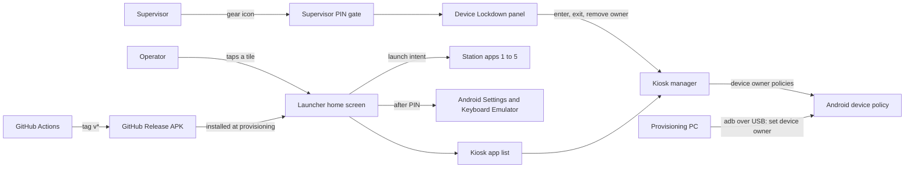

<div align="center">


<h1>PPNAM Station Launcher</h1>

The home screen of the PPNAM Chainway C72 handheld scanners.<br>
Operators tap a tile to open the app for their station. On a provisioned handheld the launcher<br>
also locks the device down (kiosk mode), so only the PPNAM apps can be used.

</div>

<p align="center">
  
</p>

<p align="center">
  <a href="https://github.com/Systems-One/PPNAM_Launcher_AA/releases/latest"><b>Latest release</b></a> ·
  <a href="#documentation"><b>Documentation</b></a> ·
  <a href="docs/sop/PPNAM_Launcher_Handheld_SOP.pdf">Handheld SOP (PDF)</a> ·
  <a href="docs/sop/content.md">SOP source text</a> ·
  <a href=".github/workflows/release.yml">Release workflow</a>
</p>

## Contents

- [What it does](#what-it-does)
- [What the system can do](#what-the-system-can-do)
- [How it fits together](#how-it-fits-together)
- [Status](#status)
- [Get started](#get-started)
- [Install or deploy](#install-or-deploy)
- [Documentation](#documentation)
- [Repository layout](#repository-layout)

## What it does

The launcher replaces the Android home screen on a handheld. It shows one tile per station app
and nothing else, and on a provisioned handheld it keeps the device confined to those apps. It is
developed by Systems One for PPNAM.

- Operators see a tile for each station app (Station 1 to 5) and open it with one tap.
- A station app that is missing or switched off keeps its tile, greyed out, with the reason
  under it.
- The Home button and closing a station app always come back to the launcher.
- A supervisor, with a PIN, can turn the lockdown off and on, open Android Settings, and release
  the handheld before it is decommissioned.
- The launcher does not sign anyone in, does not connect to any station or broker, and does not
  install or update the station apps.

## What the system can do

### Launcher app

Built and released (v1.0.0). The rules behind the tiles, the PIN and the lockdown panel are
covered by unit tests; the screens themselves have no automated tests.

| Area | Capability |
|---|---|
| Station tiles | A grid of tiles for Station 1 to Station 5, each opening its station app. |
| Tile status | A tile that cannot be opened is greyed out and says `Disabled` (installed but switched off in Android) or `Not installed`. |
| Version display | The header shows `Station Launcher · v<version>` taken from the build. |
| Lockdown notice | An amber strip under the header says `Kiosk is off: this scanner is unlocked` or `Not provisioned: kiosk unavailable`. No strip means the handheld is locked down. |
| Supervisor PIN | A 6-digit PIN behind the gear icon. Five wrong attempts lock the box for 30 seconds with a countdown. The count survives closing the box and restarting the app. An empty entry does not use an attempt. |
| Supervisor tiles | After the PIN, tiles for Android Settings and the Chainway Keyboard Emulator appear, marked `Supervisor`. The Keyboard Emulator tile only shows where that app is installed. |
| Orientation | The launcher screen is fixed to portrait. Back on the grid does nothing. |

### Kiosk lockdown

Written and released. It only takes effect when the launcher is the Android device owner. The
decision rules are unit tested; the device policy calls are not covered by automated tests (the
SOP screenshots were taken on an emulator set up as device owner).

| Area | Capability |
|---|---|
| Default state | On a provisioned handheld kiosk is on by default. Without device ownership every lockdown call does nothing, so a development install behaves like a normal app. |
| Forced home screen | The handheld starts on the launcher, and Home or closing an allowed app returns to it. |
| App allowlist | Only the launcher, the five station apps, Android Settings and the Chainway Keyboard Emulator can run. Recents and every other app are blocked. |
| Status bar | Shows clock, Wi-Fi and battery only and cannot be pulled down. Long-press power still offers power off and restart. |
| Device-wide portrait | Auto-rotate is turned off and the rotation held at portrait for the whole device, re-applied each time the launcher comes to the front. Needs the `WRITE_SETTINGS` permission granted at provisioning; without it rotation is left alone. |
| Blocked escapes | Safe boot, factory reset, adding users and installing from unknown sources are blocked, and there is no lock screen. |
| Exit and enter kiosk | A supervisor can release the handheld and lock it down again from the Device Lockdown panel. Leaving kiosk restores auto-rotate. |
| Remove device owner | A supervisor can give up device ownership, after a confirmation, so the apps can be uninstalled and the handheld re-provisioned. This also lifts the blocks above. |
| Unprovisioned handheld | The Device Lockdown panel explains that the handheld is not provisioned and shows the command the provisioning kit runs, on one line that can be scrolled and copied. |

### Delivery

Built and in use: release v1.0.0 was published by this workflow.

| Area | Capability |
|---|---|
| Release build | Pushing a `v*` tag builds the APK on GitHub Actions and publishes it as a GitHub Release named after the tag, with the APK attached as `PPNAM_Launcher_AA.apk`. |
| Signature check | The APK is signed with the shared PPNAM debug keystore (a repository secret). The build fails if the certificate does not match the expected SHA-256, because a different signature would break updates on provisioned scanners. |
| Manual build | Running the workflow by hand builds the APK as a workflow artifact without creating a release. |
| Operator documentation | The handheld SOP is generated from one Markdown file into a self-contained HTML file and an A4 PDF. |

## How it fits together



| Part | What it does | Where it lives |
|---|---|---|
| Home screen and dialogs | The tile grid, header, lockdown notice, PIN box, Device Lockdown panel and the remove-owner confirmation. One Compose activity. | [`MainActivity.kt`](app/src/main/java/com/mitas/ppnam/launcheraa/MainActivity.kt) |
| Kiosk app list | The apps allowed on a locked-down handheld, which are supervisor only, and the status shown under each tile. | [`KioskApps.kt`](app/src/main/java/com/mitas/ppnam/launcheraa/KioskApps.kt) |
| Kiosk manager | Applies and releases the device-owner policies: allowlist, forced home screen, restrictions, portrait lock, removing the device owner. | [`KioskManager.kt`](app/src/main/java/com/mitas/ppnam/launcheraa/KioskManager.kt) |
| Kiosk policy | The rule for when the launcher pins itself, and the rotation settings written while kiosk is on or off. | [`KioskPolicy.kt`](app/src/main/java/com/mitas/ppnam/launcheraa/KioskPolicy.kt) |
| Lockdown panel rules | Which action the panel offers and which notice the home screen shows, from the device-owner and kiosk state. | [`LockdownPanel.kt`](app/src/main/java/com/mitas/ppnam/launcheraa/LockdownPanel.kt) |
| PIN gate | Attempt counting, the 30 second lockout and input filtering, stored so they survive a restart. | [`PinGate.kt`](app/src/main/java/com/mitas/ppnam/launcheraa/PinGate.kt) |
| Device admin receiver | The component named when the launcher is made device owner. | [`KioskDeviceAdminReceiver.kt`](app/src/main/java/com/mitas/ppnam/launcheraa/KioskDeviceAdminReceiver.kt) |
| Unit tests | JVM tests for the four rule classes above. | [`app/src/test`](app/src/test/java/com/mitas/ppnam/launcheraa) |
| Release workflow | Builds, checks the signature and publishes the APK. | [`.github/workflows/release.yml`](.github/workflows/release.yml) |
| Handheld SOP | The operator and supervisor procedure, its source text, screenshots and generator. | [`docs/sop`](docs/sop) |

The station apps, the Chainway Keyboard Emulator and the PPNAM provisioning kit
(`PPNAM_Provisioning\provision.ps1`) are separate from this repository. The launcher only refers
to them by package name or by name.

## Status

| Part | State |
|---|---|
| App version | `1.0.0`, version code 10. Minimum Android 8.0 (API 26), target API 35. |
| Latest release | [v1.0.0](https://github.com/Systems-One/PPNAM_Launcher_AA/releases/latest), published 2026-11-26, one APK of about 9.6 MB. |
| Version history | The app was numbered up to 1.5.0 and then 2.0.0 before the whole fleet was reset to 1.0.0. The version code kept rising (9 to 10) so handhelds with 2.0.0 installed can still update. Only the `v1.0.0` tag exists in the repository. |
| Unit tests | 48 JVM tests in 5 test classes, all passing when run on 2026-11-27 with `gradlew :app:testDebugUnitTest`. |
| UI and device tests | None. There are no instrumented (`androidTest`) sources. The screens and the kiosk policies are checked by hand on an emulator or handheld. |
| CI | The only workflow builds and releases on a tag. It does not run the unit tests. |
| Release signing | Releases are debug builds (`assembleDebug`) signed with the shared debug keystore. The `release` build type is defined but not used by the workflow. |
| Handheld SOP | Written for launcher 1.5.0 (dated 2026-11-06). Its text and screenshots show `v1.5.0` in the header; it has not been re-issued for the 1.0.0 numbering. |
| Launcher icon | The SOP template records the Launcher's icon in the PPNAM icon pack as an open decision. The app ships with its own `ic_launcher`. |
| Version catalog | [`gradle/libs.versions.toml`](gradle/libs.versions.toml) lists libraries (MQTT, Room, DataStore, Navigation and others) that the app module does not depend on. |

## Get started

Prerequisites:

- Windows with the Android SDK (compile SDK 35). The Gradle wrapper downloads Gradle 8.7.
- A JDK. [`gradle.properties`](gradle.properties) pins `org.gradle.java.home` to
  `C:\Program Files\Android\openjdk\jdk-21.0.8`. On another machine override it, as the release
  workflow does with JDK 17: `-Dorg.gradle.java.home="<path to JDK>"`.
- A `local.properties` file with `sdk.dir`, created by Android Studio. It is not in git.

Run the unit tests (JVM only, no device needed):

```powershell
.\gradlew.bat :app:testDebugUnitTest
```

Build the debug APK (the same task the release workflow runs). The APK is written to
`app\build\outputs\apk\debug\app-debug.apk`:

```powershell
.\gradlew.bat :app:assembleDebug
```

Rebuild the handheld SOP after editing [`docs/sop/content.md`](docs/sop/content.md). This needs
Python 3.10+ with Pillow and PyYAML, and Microsoft Edge for the PDF; see the
[template guide](docs/sop/_template/README.md):

```bash
python docs/sop/_template/build_sop.py docs/sop/content.md --preview <scratch dir>
```

> [!WARNING]
> A locally built APK is signed with your own debug keystore, not the shared PPNAM one. It will
> not install over the launcher on a provisioned handheld, and uninstalling the provisioned
> launcher is not possible while it is device owner. Use an emulator or an unprovisioned handheld
> for development.

> [!WARNING]
> `dpm set-device-owner` and the launcher's **Remove Device Owner** button change who controls a
> handheld. Kiosk mode blocks factory reset, so a handheld made device owner by mistake has to be
> released from inside the launcher with the supervisor PIN. Do not run provisioning commands
> against a handheld that is in service.

## Install or deploy

Handhelds are set up by IT with the PPNAM provisioning kit, which is not part of this repository.
The steps below are the ones described in the handheld SOP (section 8).

1. Download `PPNAM_Launcher_AA.apk` from the
   [latest release](https://github.com/Systems-One/PPNAM_Launcher_AA/releases/latest) if the kit
   does not already carry it.
2. Start from a freshly reset handheld with no accounts added. Android only accepts a device
   owner on such a handheld.
3. Connect the handheld to the provisioning PC by USB, with USB debugging on.
4. Run the provisioning kit (`PPNAM_Provisioning\provision.ps1`). It installs the apps and makes
   the launcher the device owner by running
   `dpm set-device-owner com.mitas.ppnam.launcheraa/.KioskDeviceAdminReceiver`. It also allows the
   launcher to change system settings (`appops set <package> WRITE_SETTINGS allow`), which the
   portrait lock needs.
5. Open the launcher. The amber notice disappears and kiosk is on.

To take a handheld out of service, a supervisor opens the gear, enters the PIN, and uses
**Remove Device Owner**. The handheld then shows `Not provisioned: kiosk unavailable` and has to
be provisioned again before it is used.

## Documentation

| I want to | Go to |
|---|---|
| Use the launcher as an operator or supervisor (printable) | [Handheld SOP, PDF](docs/sop/PPNAM_Launcher_Handheld_SOP.pdf) |
| Read the same SOP in a browser | [Handheld SOP, HTML](docs/sop/PPNAM_Launcher_Handheld_SOP.html) (download and open; GitHub shows the source) |
| Edit the SOP text | [docs/sop/content.md](docs/sop/content.md) |
| See or replace the SOP screenshots | [docs/sop/images](docs/sop/images) |
| Rebuild the SOP, or learn the SOP layout and writing rules | [SOP template guide](docs/sop/_template/README.md) |
| Look at the SOP generator, page template and stylesheet | [build_sop.py](docs/sop/_template/build_sop.py), [template.html](docs/sop/_template/template.html), [sop.css](docs/sop/_template/sop.css) |
| Understand the October 2026 UI audit fixes (PIN gate, portrait lock, dialogs) | [UI audit fixes plan](docs/superpowers/plans/2026-10-02-ui-audit-fixes.md) |
| See how a release is built and signed | [Release workflow](.github/workflows/release.yml) |
| Check versions of the build tools and libraries | [gradle/libs.versions.toml](gradle/libs.versions.toml), [app/build.gradle.kts](app/build.gradle.kts) |
| See what the app declares to Android (home screen, device admin, permissions) | [AndroidManifest.xml](app/src/main/AndroidManifest.xml) |

## Repository layout

| Folder or file | What is in it |
|---|---|
| [`.github/workflows`](.github/workflows) | The release workflow. |
| [`app`](app) | The Android app module: build script, manifest, Kotlin sources, resources and unit tests. |
| [`app/src/main`](app/src/main) | The launcher itself: seven Kotlin files, launcher icons, strings, colours and the device-admin declaration. |
| [`app/src/test`](app/src/test) | JVM unit tests. |
| [`docs/assets`](docs/assets) | Images used by this README. |
| [`docs/sop`](docs/sop) | The handheld SOP (HTML and PDF), its source text and screenshots. |
| [`docs/sop/_template`](docs/sop/_template) | Vendored copy of the shared PPNAM SOP template: generator, page template, stylesheet, fonts and the PPNAM mark. Not edited in this repository. |
| [`docs/superpowers/plans`](docs/superpowers/plans) | Implementation plan for the October 2026 UI audit fixes. |
| [`gradle`](gradle) | The Gradle wrapper and the version catalog. |
| [`build.gradle.kts`](build.gradle.kts), [`settings.gradle.kts`](settings.gradle.kts), [`gradle.properties`](gradle.properties) | Root build configuration. |
| [`gradlew`](gradlew), [`gradlew.bat`](gradlew.bat) | Gradle wrapper scripts. |
